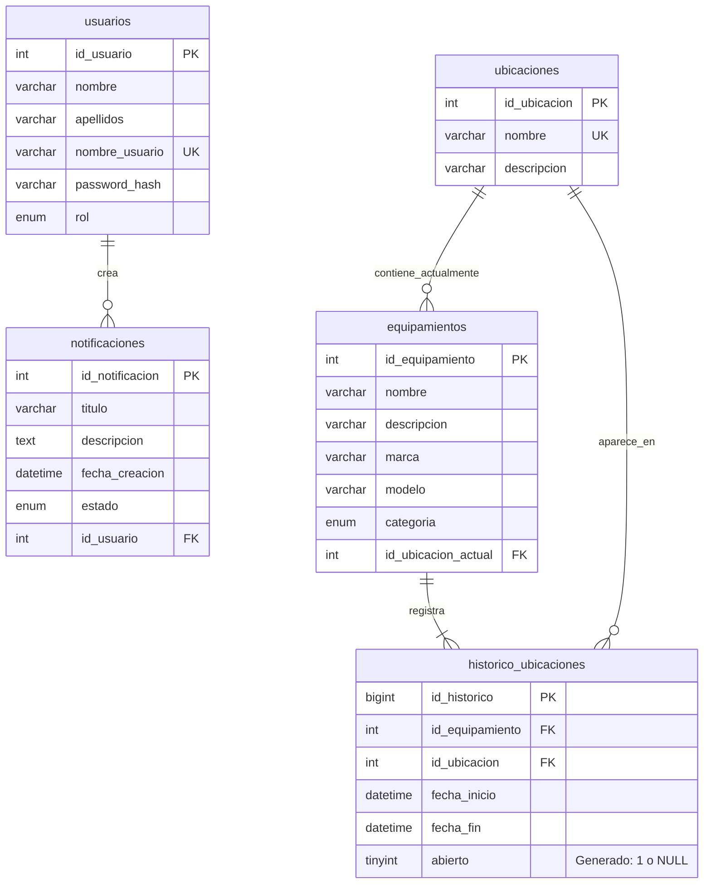

# Modelo entidad-relación editable

Fuente Mermaid: se puede editar el bloque de texto y visualizarlo con un visor Mermaid compatible. No se necesita enviar datos reales a servicios externos.

La relación de uno o más intervalos por equipo expresa el flujo de alta y traslado controlado por triggers. UNIQUE garantiza como máximo un intervalo abierto; no todas las cardinalidades de negocio se expresan únicamente mediante FK. `fecha_fin` y `abierto` admiten NULL. La clave única del histórico es compuesta por equipo y abierto.

Consulta el [diccionario con tipos exactos](DICCIONARIO_DE_DATOS.md).
