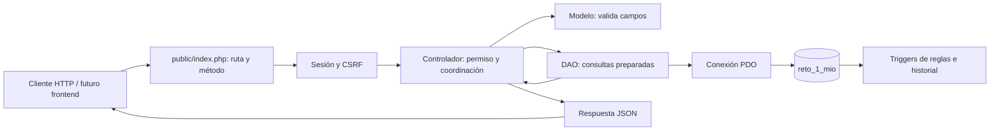
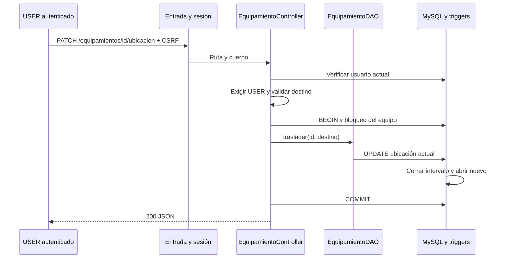

# Diagramas editables

Fuentes Mermaid: se pueden editar como texto y abrir en un visor compatible. No son imágenes cerradas ni requieren modificar el material oficial.

La comprobación de identidad consulta la BD mediante `UsuarioDAO`. El diagrama la abrevia para mostrar el flujo principal. No existe una capa Service entre controlador y DAO.
