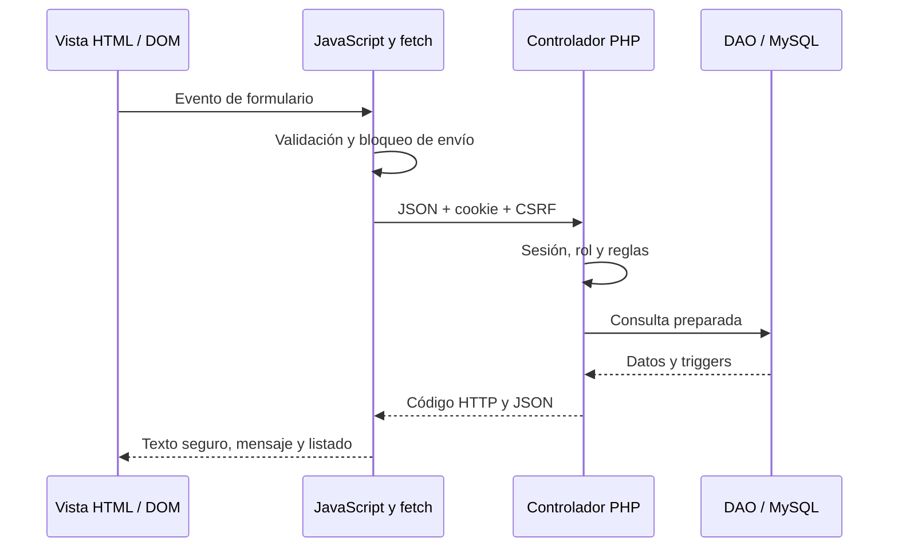

# Integración, eventos y seguridad

## Peticiones reales

`api.js` utiliza `fetch` hacia `/api`, `credentials: 'same-origin'`, Accept JSON y Content-Type JSON cuando hay cuerpo. No usa datos simulados ni una API diferente. Frontend y PHP se sirven desde `http://127.0.0.1:8080`.

Al arrancar se solicita GET `/api/sesion`. La cookie es HttpOnly y JavaScript no la lee. El token CSRF recibido se guarda en una variable del módulo y se envía como `X-CSRF-Token` en toda escritura. Login/logout devuelven un token renovado. Recargar la página vuelve a obtener el token; no se persiste en almacenamiento del navegador.

Las rutas y cuerpos coinciden con la [documentación del backend](../backend/ENDPOINTS.md). PUT envía campos completos de edición; PATCH se utiliza para traslado o estado. Se omite la contraseña vacía al editar usuario. La ubicación del alta, el autor y el estado inicial de avisos no se envían desde formularios.

## Eventos y DOM

| Evento | Comportamiento |
|---|---|
| submit en acceso | Login asíncrono y carga del inventario |
| click en navegación / hashchange | Cambia pantalla sin recargar el documento; soporta atrás/adelante |
| change en categoría | Nueva consulta al servidor con filtro |
| click en Actualizar | Revalida sesión/rol y vuelve a consultar |
| click en acción de fila | Abre detalle, formulario o confirmación |
| input en campo | Limpia validación anterior para permitir corregir |
| submit en formulario | Valida, bloquea doble envío, guarda y actualiza listado |
| cancel/close del diálogo | Escape/cierre y foco restaurado, salvo escritura pendiente |

`createElement`, `textContent`, `append` y `replaceChildren` construyen las vistas. No se usa innerHTML, eval o plantillas HTML para datos del servidor. El contenido malicioso de un registro se muestra como texto y se comprueba en Chrome con una descripción de prueba que contiene una etiqueta img.

Un contador de versión descarta lecturas antiguas si se cambia rápidamente de sección. El detalle comprueba que su indicador de carga siga en el diálogo antes de pintar una respuesta tardía. Son medidas de presentación; no alteran reglas del backend.

## Validación y errores

El navegador comprueba campos obligatorios y límites. JavaScript rechaza texto compuesto solo por espacios y valida bytes de contraseña (12–72) y descripción TEXT (65535). El backend sigue siendo la validación definitiva. La contraseña no se recorta ni se vuelve a mostrar. En edición se deja vacía para conservarla.

Se muestran mensajes legibles para errores del API. Un fallo de red ofrece Actualizar/reintento; no repite automáticamente escrituras. Si el guardado terminó pero la lectura posterior falla, no se invita a duplicar el alta. Si la sesión desaparece o recibe 401, se vuelve al acceso y se obtiene un token nuevo. Un 403 se comunica sin convertirlo en éxito ni intentar la operación con otro rol.

Tras un 403 se relee la identidad efectiva, se actualiza el perfil y, si cambió cuenta/rol, se cierra el formulario antiguo y se recargan los controles. Login muestra nombre y rol, para evitar confundir una cuenta denominada conserje con un rol ADMIN guardado en MySQL. La [revisión de ubicaciones](../backend/REVISION_PERMISOS_UBICACIONES.md) contiene una prueba real de este cambio de rol.

## Ajustes PHP para la integración

GET `/` y `/index.html` sirven la vista inicial; las rutas `/api/...` siguen usando el MVC existente. El router permite los CSS/JS locales previstos. La vista inicial añade CSP para scripts/estilos/conexiones del mismo origen, sin inline JavaScript ni recursos remotos. `.htaccess` se adapta también, pero su ejecución en Apache queda pendiente.

La sesión PHP se inicia **después de comprobar ruta y método**. Se detectó en el navegador que una petición a una ruta desconocida, como favicon.ico, podía generar una cookie competidora durante el arranque. Se corrigió y se añadió una regresión HTTP: una ruta desconocida no devuelve Set-Cookie. No se relajó CSRF ni se modificó la base de datos.

